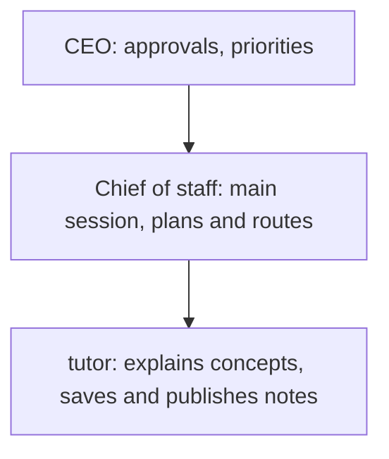

# Team: learning-notes

## Involvement log

| Date | Who | What |
|---|---|---|
| 2026-11-14 | background agent | Project created (T-20261114-5): tutor and learn-fast moved here with symlinks back to `~/.claude/`, notes, checks, public repo. |
