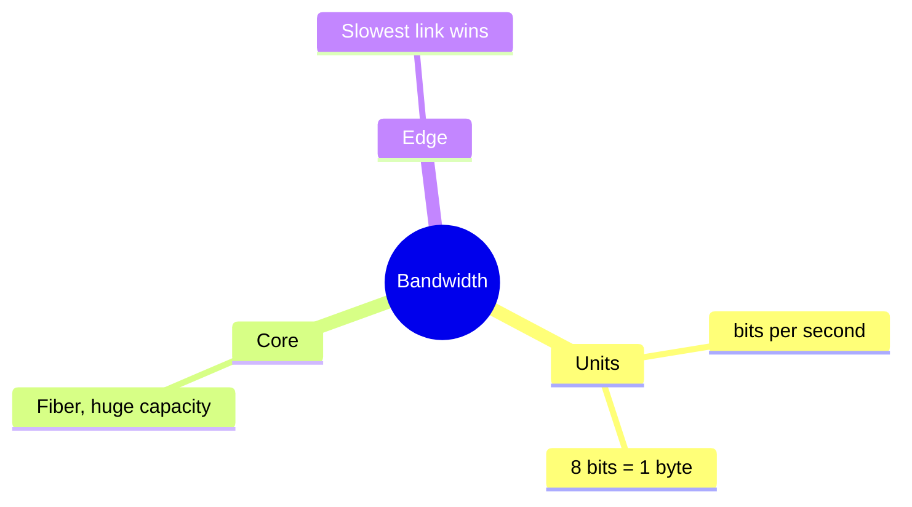

# Bandwidth

**Core:** Bandwidth is the maximum amount of data a path can carry per second. It matters for big transfers, much less for small web requests.

## Key points
- Measured in bits per second (bps). File sizes are in bytes. 1 byte = 8 bits.
- The core of the Internet is fiber with huge capacity. The edge (home, mobile) is the limit.
- Your usable bandwidth is the slowest link between you and the server.
- Adding bandwidth is easy (more fibers, better multiplexing). Latency cannot be improved the same way.
- Small transfers spend most of their time waiting on round trips, so more bandwidth barely helps them.

## Picture

## Example
A 10 MB file is 80 Mb. On a 1 Mbps link that takes 80 seconds to put on the wire.

## Related
- [Latency](latency.md)

_Updated: 2026-11-14_
