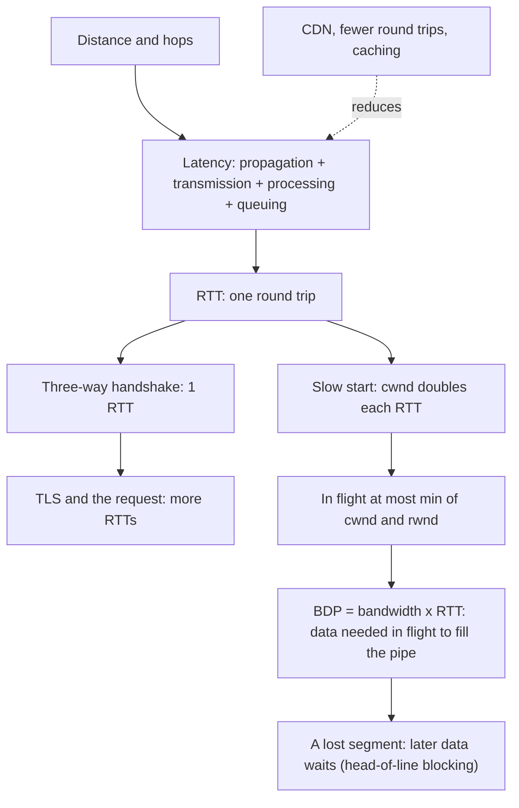

# Networking: core concepts

**Core:** Speed is a feature. Network speed is set by latency (waiting) and bandwidth (pipe width), and latency is usually the bottleneck. TCP then adds reliability on top, at the cost of round trips.

## Primer on latency and bandwidth

**Speed is a feature**
- Faster sites mean better engagement, retention and conversions.
- Latency: time from sending a packet to it being received. Bandwidth: maximum throughput of a path.

**The many components of latency**
- Total latency is the sum of four delays: propagation (distance / signal speed), transmission (packet size / link rate), processing (router reads the header), queuing (waiting in a buffer).
- Every router on the path repeats the last three. Oversized buffers (bufferbloat) inflate queuing delay.
- Network rates are in bits per second, file sizes in bytes. 1 byte = 8 bits, so 10 MB over a 1 Mbps link takes 80 s.

**Speed of light and propagation latency**
- Light in fiber is about 200,000 km/s. Distance sets a hard minimum delay that no hardware can beat.
- RTT (round-trip time) is there and back. New York to London is about 56 ms in fiber at best; real routes are longer.
- People notice lag at 100 to 200 ms, find it sluggish above 300 ms, and lose focus around 1 s.
- A CDN shortens the distance by serving cached copies from a nearby server.

**Last-mile latency**
- The first hops from your home to the ISP often add 10 to 65 ms (fiber lowest, DSL highest, per FCC figures in the source).
- `traceroute` shows each hop and its delay.

**Bandwidth in core networks**
- The core is fiber. Wavelength-division multiplexing sends many wavelengths down one fiber, so capacity is very large.
- More capacity is cheap to add: more fibers, more links, better multiplexing.

**Bandwidth at the network edge**
- The edge (home, mobile, local router) is far slower than the core.
- Your usable bandwidth is the slowest link between you and the server.

**Delivering higher bandwidth and lower latencies**
- Bandwidth can keep growing. Latency cannot beat the speed of light, so better fiber gains at most about 30%.
- So: reduce round trips, move data closer (CDN), cache and prefetch.

## Building blocks of TCP

**Three-way handshake**
- SYN, SYN-ACK, ACK. Costs one round trip before any data. Only the two endpoints take part, routers just forward.
- TLS adds one or two more round trips, then the request takes another.

**Congestion avoidance and control**
- Two limits, and the sender uses the smaller: `min(cwnd, rwnd)` bytes in flight.
- rwnd: free space in the receiver's buffer, sent back in every ACK. cwnd: the sender's own guess of what the network can carry, never sent over the wire.
- Slow start: cwnd begins around 10 packets and doubles each round trip. Congestion avoidance: slow growth after that. Loss: cwnd is cut, then grows again.
- TCP retransmits lost segments itself, so the app never sees it.

**Bandwidth-delay product** (overview, to study next)
- BDP = bandwidth x RTT: how much data must be in flight to keep the pipe full. A window smaller than the BDP leaves the link underused.

**Head-of-line blocking** (overview, to study next)
- TCP delivers bytes in order. If one segment is lost, later data that already arrived waits until it is retransmitted.

**Optimizing for TCP** (overview, to study next)
- Fewer round trips (reuse connections), data closer to the user, and an up-to-date server TCP stack.

## Picture

How the concepts connect: [watch the TCP animation](tcp.html) for the handshake, numbered segments, rwnd and cwnd.

## Example
New York to London is about 56 ms round trip. Handshake, TLS and the request take about 3 round trips, roughly 170 ms before the first byte, on any bandwidth. A server in London removes the crossing.

## Related
- [File journey (isometric map)](file-journey.html)
- [TCP animation](tcp.html)

_Updated: 2026-11-15_
