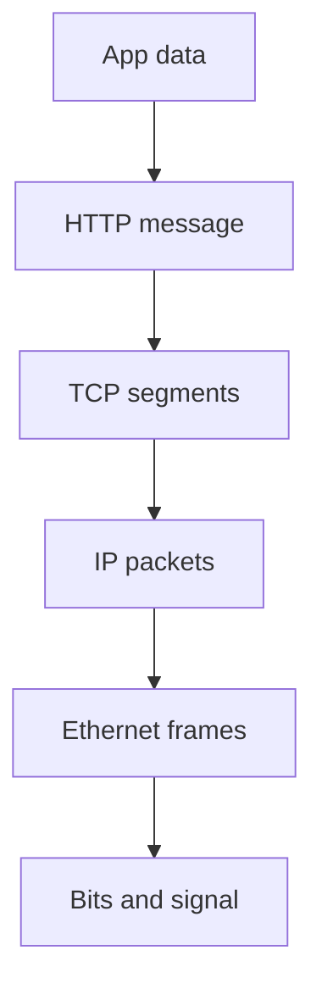

# Encapsulation (layers)

**Core:** Each layer wraps the data from the layer above with its own header. At the bottom the result becomes bits, then a physical signal.

## Key points
- App data goes in an HTTP message, then a TCP segment, then an IP packet, then an Ethernet frame, then bits.
- **TCP header:** ports, sequence numbers. **IP header:** source and destination IP. **Ethernet header:** MAC addresses.
- Who does it: the app (HTTP, TLS), the kernel (TCP and IP), the network card and its driver (Ethernet, signal).
- The signal depends on the medium: voltage on copper, light on fiber, radio on WiFi.
- Receiving is the same in reverse: each layer strips its header.
- Routers read only up to the IP header. They rebuild the frame with new MAC addresses for each hop. IP addresses stay the same end to end.

## Picture

## Example
A 4,000 byte file becomes one HTTP message, then about three TCP segments, three IP packets and three frames.

## Related
- [Ethernet frame](ethernet-frame.md)
- [TCP vs UDP](tcp-vs-udp.md)

_Updated: 2026-11-14_
