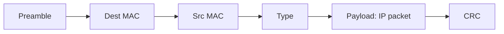

# Ethernet frame

**Core:** The unit sent on a local link. The network card finds frames in the bit stream using a fixed format and passes the payload up to the kernel.

## Key points
- Fields: destination MAC, source MAC, type, payload, CRC.
- **MAC:** hardware address of a network card, only valid on the local link.
- **Type (EtherType):** says what the payload is (IPv4, IPv6, ARP). This is the link to the upper layer.
- **CRC:** checksum (cyclic redundancy check). A mismatch means corruption, so the frame is dropped.
- **MTU:** largest payload per frame, 1500 bytes on standard Ethernet. Bigger data is split into many frames.
- Frames carry no file identity. Matching to a connection and order is done by the IP and TCP headers inside the payload.
- A frame starts with a fixed bit pattern (preamble) that the card recognises. The card is mostly fixed hardware, not a general CPU, and copies frames into RAM (DMA).

## Picture

## Example
The card receives bits, spots the preamble, reads the fields at fixed positions, checks the CRC, and hands the IP packet to the kernel.

## Related
- [Encapsulation](encapsulation.md)

_Updated: 2026-11-14_
