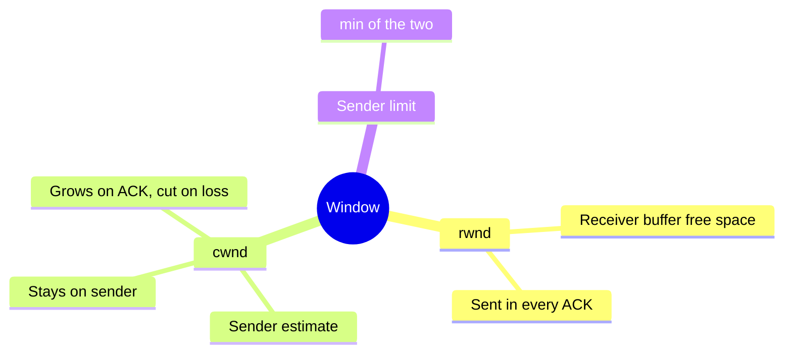

# Flow and congestion control

**Core:** A TCP sender may only have a limited amount of unacknowledged data in flight: the smaller of the receiver's window and its own congestion window.

## Key points
- **rwnd** (receive window): free space in the receiver's buffer. Sent back in every ACK. Protects the receiver.
- **cwnd** (congestion window): the sender's own guess of what the network can carry. Never sent over the network. Protects the path.
- Sender can have at most `min(cwnd, rwnd)` bytes in flight.
- Receive buffer is kernel RAM, one per connection. A slow reading app leaves it full, so rwnd shrinks, down to 0.
- **Slow start:** cwnd starts small (about 10 packets) and doubles each round trip.
- **Congestion avoidance:** after a limit, it grows slowly. On loss, it is cut, then grows again.
- Lost packets are retransmitted by TCP itself. The app only sees an error if the connection fails.

## Picture

## Example
Receiver buffer is 64 KB. After it holds 64 KB unread, rwnd is 0 and the sender stops until the app reads. In Node, `socket.pause()` causes this and `write()` returns `false` as backpressure.

## Related
- [TCP handshake](tcp-handshake.md)
- [TCP vs UDP](tcp-vs-udp.md)

_Updated: 2026-11-14_
