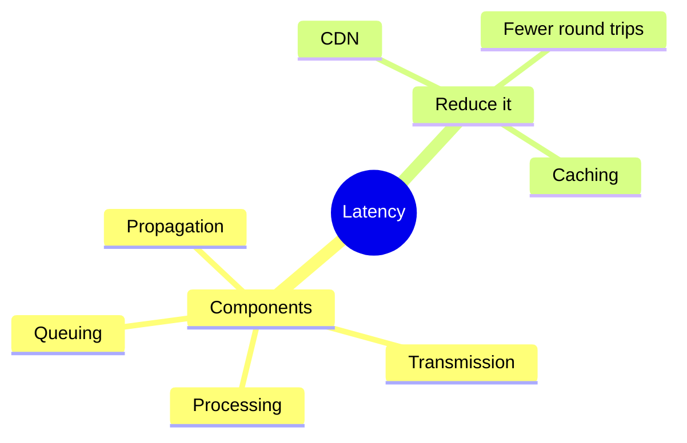

# Latency

**Core:** Latency is the time for a packet to get from sender to receiver. It has a physical floor, the speed of light, and it is usually the bottleneck for websites.

## Key points
- **RTT** (round-trip time): there and back again.
- Four parts add up: propagation (distance), transmission (packet size / link rate), processing (router reads header), queuing (waiting in a buffer).
- Light in fiber is about 200,000 km/s, so distance sets a minimum delay. Better hardware cannot beat it.
- More hops means more processing, queuing and transmission delay on top of the floor.
- The last mile (your home to the ISP) often adds tens of milliseconds.
- To cut latency: shorten the distance (CDN, nearby server), reduce round trips, cache and prefetch.
- **CDN:** cached copies of content on servers near users.

## Picture

## Example
New York to London is about 56 ms round trip in fiber at best. A server in London removes that crossing for London users.

## Related
- [Bandwidth](bandwidth.md)
- [TCP handshake](tcp-handshake.md)

_Updated: 2026-11-14_
