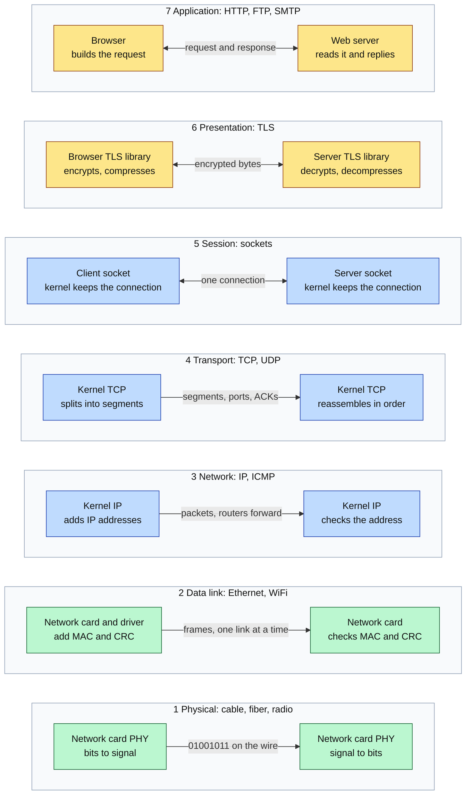
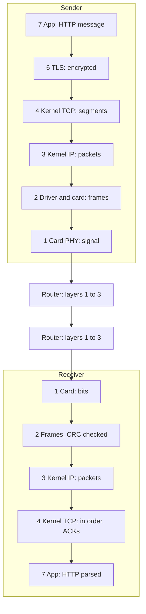

**Core:** A file is wrapped layer by layer on the sender (browser, kernel, network card), forwarded by routers that read only up to layer 3, then unwrapped in reverse on the receiver.

## Key points

**Sender: who does what**

| Layer | Who | What happens | Data |
|---|---|---|---|
| 7&nbsp;Application | Browser | Builds the HTTP POST with the file in the body | HTTP message |
| 6&nbsp;Presentation | Browser (TLS) | Encrypts the message | Encrypted bytes |
| 5&nbsp;Session | App and TCP | Connection state. In practice folded into the app and TCP | Byte stream |
| 4&nbsp;Transport | Kernel (TCP) | Handshake first. Splits the stream into segments (about 1460 bytes), adds ports and sequence numbers, waits for ACKs | Segments |
| 3&nbsp;Network | Kernel (IP) | Adds source and destination IP address | Packets |
| 2&nbsp;Data&nbsp;link | Driver and card | Adds MAC addresses, type and CRC. Payload at most 1500 bytes (MTU) | Frames |
| 1&nbsp;Physical | Network card | Bits become voltage (copper), light (fiber) or radio (WiFi) | Signal |

**Browser to kernel**
- The app calls `send()`. The bytes are copied into the kernel's send buffer, one per connection, in RAM.
- If the buffer is full, `send()` blocks (in Node, `write()` returns `false`: backpressure).
- Before data, the kernel did the TCP handshake (SYN, SYN-ACK, ACK), one round trip.
- TCP sends at most `min(cwnd, rwnd)` unacknowledged bytes. cwnd is the sender's own guess (slow start doubles it each round trip). rwnd is the receiver's free buffer, carried in every ACK.

**Network card**
- Sending: the driver hands over the IP packet. Header fields (MACs, type) and the CRC are added, and the PHY turns bits into a signal.
- Receiving: the PHY gives bits. Hardware spots the start marker (7 bytes of `10101010`, then `10101011`) and reads fields at fixed positions. It checks the destination MAC and the CRC, drops damaged frames, then copies the payload into RAM (DMA) and interrupts the CPU. It is mostly fixed hardware, not a general CPU.
- A frame has MAC addresses, type, payload and CRC. It carries no file identity.

**Routers in between**
- Each hop strips the old frame, reads the destination IP, picks the next hop from its routing table, and wraps the same packet in a new frame with new MAC addresses.
- MAC addresses change at every hop. IP addresses stay the same end to end.
- Routers work only up to layer 3 and never join the TCP handshake. Each hop adds processing, queuing and transmission delay.

**Receiver: the reverse**
- Network card: signal, bits, frames (CRC and MAC checked), then the packet goes to RAM.
- Kernel IP: checks the destination IP and strips the header.
- Kernel TCP: finds the connection by its 4-tuple (source IP, source port, destination IP, destination port), puts segments in order by sequence number, sends ACKs with its rwnd, and fills the per-connection receive buffer in RAM.
- App: reads the buffer (Node `'data'`, `recv()`), which frees space and grows rwnd. A slow reader leaves the buffer full, so rwnd shrinks to 0 and the sender stops.
- TCP has no message boundaries, so HTTP parses the stream: headers first, then the body length it announced.

## The layers at a glance

Each row is one layer: who does it on the sending side, the protocols, and who does it on the receiving side. Colors show where it happens: yellow is the app (browser or server), blue is the kernel, green is the network card. The wire itself is the arrow between the two sides in the bottom row.

## Picture

Interactive map of the whole journey. Scroll to zoom, drag to pan.

<iframe src="file-journey.html" width="100%" height="560" style="border:0" loading="lazy" title="File journey animation"></iframe>

The same journey as a video (from the typed address to the ACK):

<video src="assets/file-journey.mp4" controls width="100%"></video>

[Open the video file](assets/file-journey.mp4) or the [full-page interactive map](file-journey.html).

## Example
A 4000 byte `notes.txt` (HTTP and TLS overhead ignored): one HTTP message, then 3 TCP segments (1460 + 1460 + 1080 bytes), 3 IP packets, 3 frames, then bits as a signal. The receiver reverses each step and rebuilds the same 4000 bytes.

## Related
- [TCP](tcp-basics.md)
- [Routing](routing.md)
- [TCP animation](tcp.html)
- [Networking mind map](assets/networking.mindmap.html)
