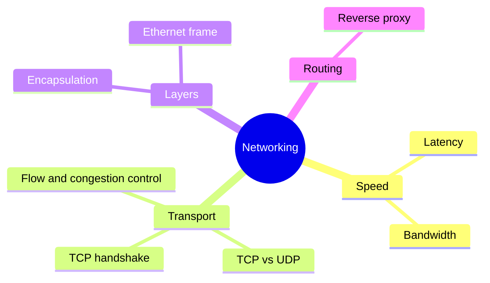

# Networking overview

**Core:** Start here. Each branch links to a short note you can open for more detail.

## Key points
- Speed on the web is mostly about **latency** (waiting), not **bandwidth** (width of the pipe).
- Data is wrapped in layers on the way down and unwrapped on the way up.
- TCP adds reliability on top of IP: handshake, ACKs, and window limits.

## Picture

Open a note for more detail:
- Speed: [Latency](latency.md), [Bandwidth](bandwidth.md)
- Transport: [TCP vs UDP](tcp-vs-udp.md), [TCP handshake](tcp-handshake.md), [Flow and congestion control](flow-and-congestion-control.md)
- Layers: [Encapsulation](encapsulation.md), [Ethernet frame](ethernet-frame.md)
- Routing: [Reverse proxy](reverse-proxy.md)

## Example
A page load: encapsulate the request (layers), open a connection (handshake), send within the windows (flow and congestion control), and wait round trips (latency).

## Related
- [Latency](latency.md)
- [Encapsulation](encapsulation.md)

_Updated: 2026-11-14_
