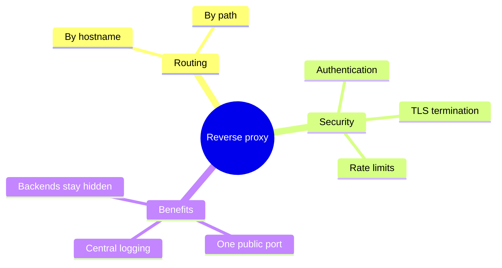

# Reverse proxy

**Core:** A reverse proxy is one front door that routes requests to many backend services by hostname or path.

## Key points
- Clients talk only to the proxy, never to the backends directly.
- It routes by hostname or path, so many apps share ports 80 and 443.
- It can terminate TLS once, so backends need no certificates.
- It can add caching, rate limits and authentication in one place.

## Picture

## Example
A server runs two apps on ports 3000 and 3001. The proxy receives `https://notes.example.com` and forwards it to port 3000, and `https://wiki.example.com` to port 3001. Only port 443 is open to the network.

## Related
- [Notes index](../README.md)

_Updated: 2026-11-14_
