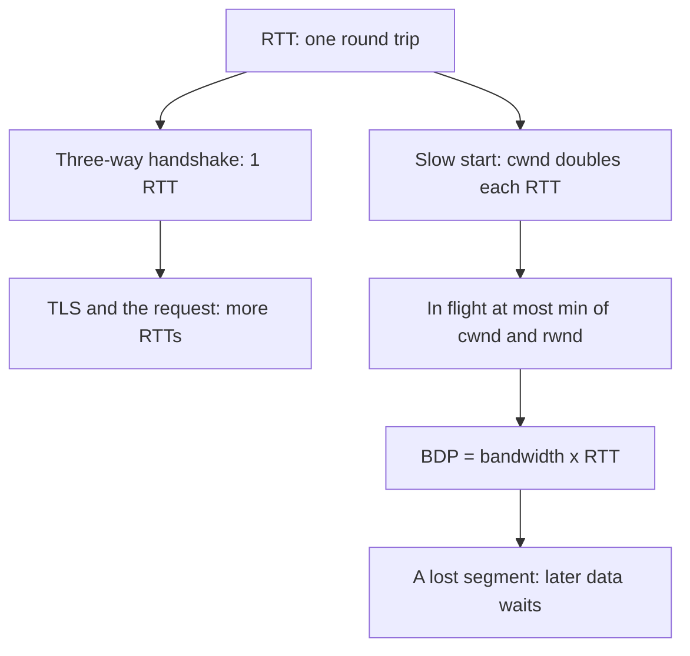

**Core:** TCP adds reliability on top of an unreliable network: it connects first, numbers every byte, resends what is lost and slows down when the network is full. The price is round trips.

## Three-way handshake

- SYN, SYN-ACK, ACK. One round trip before any data.
- Only the two endpoints take part. Routers just forward.
- TLS adds one or two more round trips, then the request takes another.

## Flow and congestion control

- The sender keeps at most `min(cwnd, rwnd)` bytes in flight.
  - rwnd: free space in the receiver's buffer, sent back in every ACK.
  - cwnd: the sender's own guess of what the network can carry. Never sent over the wire.
- Slow start: cwnd begins around 10 packets and doubles each round trip.
- Congestion avoidance: slow growth after that.
- On loss, cwnd is cut, then grows again.
- TCP retransmits lost segments itself, so the app never sees it.
- A slow reader leaves the receive buffer full, so rwnd shrinks to 0 and the sender stops. In Node this shows up as backpressure (`write()` returns `false`).

## To study next

- Bandwidth-delay product: bandwidth x RTT, the data that must be in flight to fill the pipe. A smaller window leaves the link underused.
- Head-of-line blocking: TCP delivers bytes in order, so one lost segment makes later data wait.
- Optimizing for TCP: fewer round trips (reuse connections), data closer to the user, a current server TCP stack.

## Picture

[Watch the TCP animation](tcp.html): handshake, numbered segments, rwnd and cwnd.

## Related

- [Speed: latency and bandwidth](speed.md)
- [The journey of a file](osi-file-journey.md)
- [Networking](index.md)
