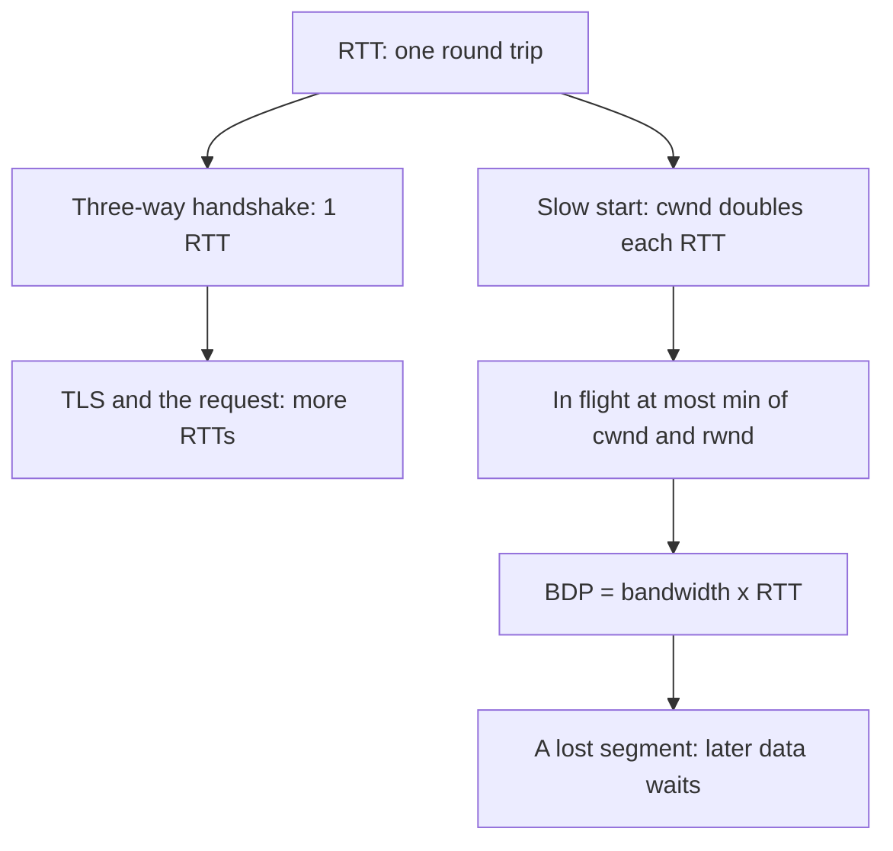

**Core:** TCP adds reliability on top of an unreliable network: it connects first, numbers every byte, resends what is lost and slows down when the network is full. The price is round trips.

## Three-way handshake

- SYN, SYN-ACK, ACK. One round trip before any data.
- Only the two endpoints take part. Routers just forward.
- TLS adds one or two more round trips, then the request takes another.

## Flow and congestion control

- The sender keeps at most `min(cwnd, rwnd)` bytes in flight.
  - rwnd: free space in the receiver's buffer, sent back in every ACK.
  - cwnd: the sender's own guess of what the network can carry. Never sent over the wire.
- Slow start: cwnd begins around 10 packets and doubles each round trip.
- Congestion avoidance: slow growth after that.
- On loss, cwnd is cut, then grows again.
- TCP retransmits lost segments itself, so the app never sees it.
- A slow reader leaves the receive buffer full, so rwnd shrinks to 0 and the sender stops. In Node this shows up as backpressure (`write()` returns `false`).

## Window size and the round trip

- Speed is capped at window / RTT, so a long RTT needs a bigger window to keep the same speed.
- The window needed is the bandwidth-delay product (BDP): bandwidth x RTT, the data on the wire during one round trip.
- Nobody calculates the window. cwnd explores: it grows while ACKs return and is cut on loss.
- Window scaling lets the receive window grow past 64 KB. The receiver's auto-tuning grows its kernel buffer.
- The kernel adjusts windows by itself. You tune it only when its limits are too low.

## Head-of-line blocking

- TCP delivers bytes in order. If one segment is lost, later segments wait in the receiver's buffer until the lost one is resent.
  - The app sees only a delay, not the resend.
- The cost: an extra round trip, and uneven arrival times (jitter).
- The benefit: the app never has to reorder data.
- Jitter-sensitive apps (voice calls) break when arrival times vary.

## TCP vs UDP

- TCP: complete, ordered data, such as files and JSON. A lost packet is resent.
- UDP: no guarantee, but no waiting. Use it when old data is worthless.
  - Live audio and video, games, WebRTC, DNS.
- Packet loss is TCP's feedback: it tells the sender to slow down.
- QUIC (HTTP/3) runs on UDP and adds its own reliability.

## TCP and UDP in my own words

**TCP**

When two machines communicate, the sender splits the data into segments. The size of each segment is capped at a maximum (about 1460 bytes), not decided by how much data there is. Every segment gets a sequence number. When they arrive, they can come in a different order, so the TCP layer in the kernel puts them back in order and puts the data together. The receiver sends ACKs, and if the sender does not get an ACK for a segment, it sends it again. So the protocol makes sure all the data arrives safe and in the right order. That is what separates TCP from UDP: reliability. The price is mostly latency, because those checks are not free: a handshake first, then ACKs, and congestion control that slows the sender down when the network is full.

**UDP**

UDP prioritizes speed and removes all of that orchestration. There is no handshake, no ACK, no ordering and no congestion control. The data goes straight from sender to receiver. UDP does not split the data: each message the app sends becomes one datagram, so the app keeps messages small. Ordering matters less for DNS and live streaming, because if a datagram is lost, newer data arrives straight after and replaces it. (Video on demand, such as Netflix, normally runs over TCP, with HTTP.) The opposite case is a bank transaction, where the data must arrive complete and with integrity, even if a bit late, so it uses TCP.

## Optimizing for TCP

- The core: the handshake costs a round trip, slow start applies to every new connection, and cwnd sets the throughput. So latency, not bandwidth, is usually the bottleneck.
- Send fewer bits: drop unneeded resources and compress.
- Move the bits closer: servers near the user, or a CDN.
- Reuse connections (keep-alive, HTTP/2, connection pools): it avoids repeated handshakes and slow starts.
- Keep servers on a recent kernel. It is the best single tuning.
- Server settings: initial cwnd 10, window scaling on, slow-start restart off.
- TCP Fast Open: first data goes in the SYN. It needs both sides and is rarely used.

## Inspect connections

- `ss` is the Linux tool to inspect open connections and their settings.
- `ss -ti` shows TCP details per connection, such as the window scale (`wscale`) that was negotiated.

## Picture

[Watch the TCP animation](tcp.html): handshake, numbered segments, rwnd and cwnd.

## Related

- [Speed: latency and bandwidth](speed.md)
- [The journey of a file](osi-file-journey.md)
- [Networking](index.md)
