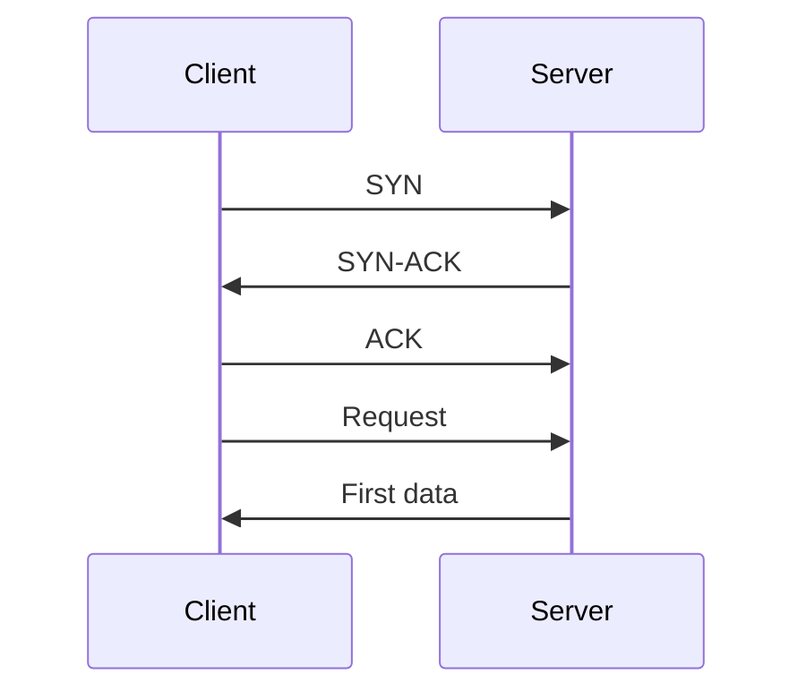

# TCP handshake

**Core:** Before any data flows, the two endpoints exchange three messages. It costs one round trip, which is why latency dominates small requests.

## Key points
- Three steps: SYN, SYN-ACK, ACK.
- Only the two endpoints take part. Routers in between just forward packets.
- TLS (encryption) adds one or two more round trips after it.
- Then the request itself takes another round trip before the first bytes return.
- Closing a connection is a separate exchange (FIN and ACK steps).

## Picture

## Example
With a 56 ms round trip, handshake plus TLS plus request is about 3 round trips, roughly 170 ms before the first byte. This is the same on a slow or a fast link.

## Related
- [Latency](latency.md)
- [Flow and congestion control](flow-and-congestion-control.md)

_Updated: 2026-11-14_
