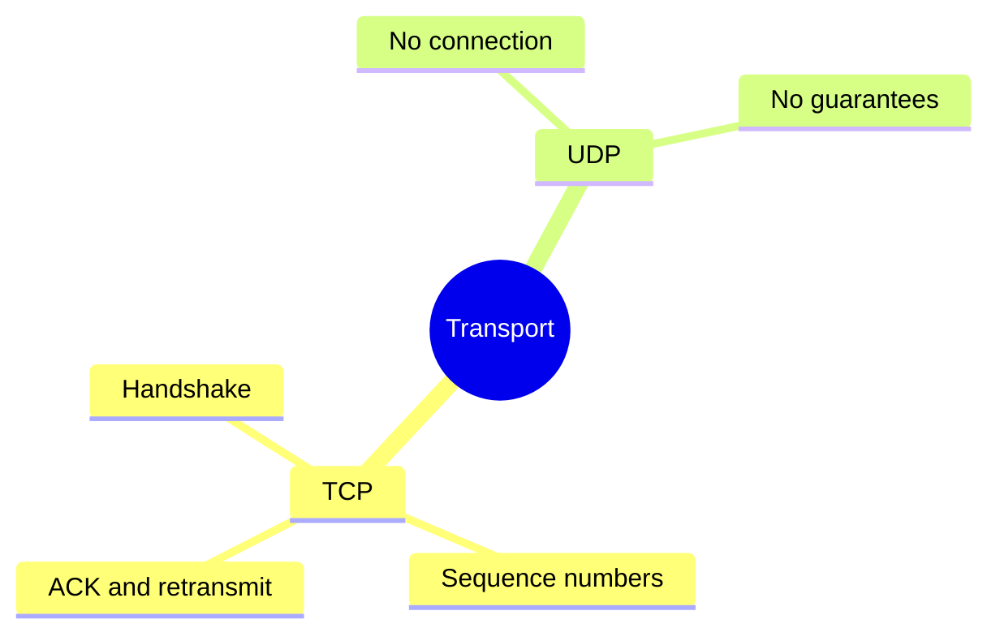

# TCP vs UDP

**Core:** TCP delivers a reliable, ordered byte stream. UDP just sends independent packets with no guarantees.

## Key points
- **TCP:** handshake first, splits data into numbered segments, receiver reorders and ACKs, sender retransmits lost ones.
- TCP has no message boundaries: it is a stream, so the app protocol (for example HTTP) defines where messages start and end.
- **UDP:** no handshake, no numbering, no ACKs, no retransmits. Each send is one datagram.
- Pick TCP when correctness matters, UDP when speed matters and the app can handle loss.

## Picture

## Example
A web page download uses TCP. A live game or voice call often uses UDP.

## Related
- [TCP handshake](tcp-handshake.md)
- [Flow and congestion control](flow-and-congestion-control.md)

_Updated: 2026-11-14_
