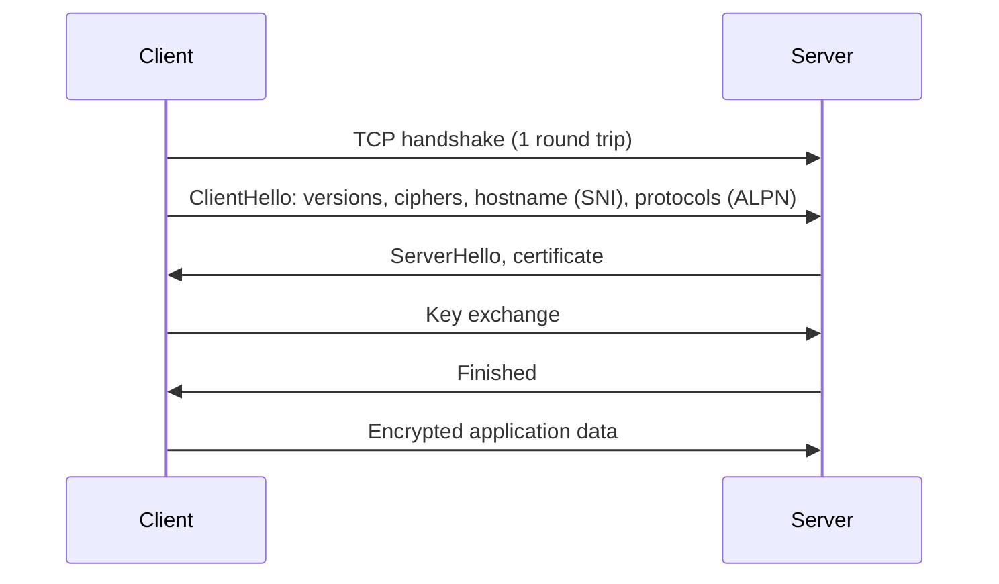

**Core:** TLS wraps TCP so nobody on the path can read or change the data, and you know who you are talking to. The price is extra round trips at the start.

## Why TLS

- **Problem:** plain TCP crosses many routers, and anyone along the path can read or change the data.
- **Solution:** TLS gives three things:
  - Encryption: nobody can read it.
  - Authentication: the server is who it claims to be.
  - Integrity: nobody can change it unnoticed.

- It sits on top of TCP, so HTTP stays unchanged. HTTP plus TLS is HTTPS.

## Agreeing a key

- **Problem:** two strangers must agree on a secret key over an open wire.
- **Solution:** the handshake uses public-key maths (Diffie-Hellman) to agree a shared key without ever sending it.

- Then fast symmetric encryption protects all the data. Public-key maths is slow, so it runs only at the start.
- A new ephemeral key for each session gives forward secrecy: a stolen server key cannot decrypt old recorded sessions.

## Knowing who you talk to

- **Problem:** an attacker can pretend to be the bank and still encrypt to you.
- **Solution:** the server sends a certificate signed by a certificate authority (CA).

- The chain: site certificate, then intermediate CA, then root CA.
- Your browser or OS ships with the list of trusted roots. A chain that ends at a trusted root is trusted.
- A CA can revoke a certificate. OCSP stapling lets the server prove it is still valid.
- Let's Encrypt gives these certificates for free.

## The cost: round trips

- **Problem:** the handshake costs round trips before any data.
- **Solution:** resumption, TLS 1.3, connection reuse and servers near the user.

- Session resumption: a returning visitor reuses the old keys and skips a round trip (session IDs or tickets).
- TLS 1.2 needs 2 round trips for a new connection. TLS 1.3 needs 1 for a new one and 0 for a resumed one.
- Reuse connections (keep-alive) and use a CDN to shorten the round trip.

## Two small extras

- SNI: the client names the hostname inside the handshake, so one IP can serve many sites with their own certificates.
- ALPN: client and server agree on the application protocol (HTTP/2 or HTTP/1.1) in the same handshake, with no extra round trip.

## Picture

## Example

New York to London is about 56 ms round trip. The TCP handshake takes 56 ms and a TLS 1.2 handshake another 112 ms, so the first data leaves at about 168 ms. TLS 1.3 saves one round trip, and resumption saves more.

## Related

- [TCP](tcp-basics.md): the handshake that TLS builds on.
- [Speed: latency and bandwidth](speed.md): why round trips matter.
- [Reverse proxy](reverse-proxy.md): often ends TLS once for all backends.
- [Networking](index.md)
