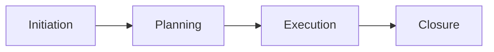

**Core:** Governance sets who decides what. The project board sets the limits, the project manager works inside them, and independent assurance checks both.

## Governance

- **Problem:** without clear boundaries, nobody knows who may approve changes or who is accountable.
- **Solution:** governance: clear limits, a route for change requests, and defined roles.

- It works on two levels: governing one project, and governing how the whole organisation runs projects.

## Roles

- Project board:
  - Executive: owns the business case and has the final say.
  - Senior User: speaks for those who will use the result.
  - Senior Supplier: speaks for those who build it.
- Project manager: runs the project day to day, within limits (tolerances) set by the board.
- Team manager: delivers the work packages.
- Project assurance: independent of the project manager, checks the project is on track.
- Change authority: a person or group the board can give the power to approve changes.
- If the project manager goes beyond tolerance, they escalate to the board.

## Life cycle

- Initiation: justify the project and define the need.
- Planning is the most critical phase: it balances cost, time and scope.
- Execution: build and control.
- Closure: hand over and record lessons.
- Waterfall: finish each phase before the next. Agile: small, frequent deliveries that respond to feedback.
- No single method suits every project.

## Needs analysis

- Measure the gap between the current and the desired situation, during initiation.
- Gather information, name the problem and risks, compare options, agree, then get sign-off.

## Related

- [Business case](business-case.md)
- [Change and closure](change-closure.md)
- [Project management](index.md)
