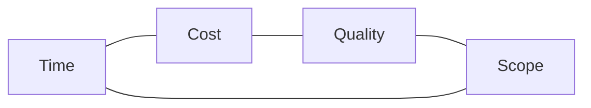

**Project management** is how an organisation turns strategy into results: it runs a temporary, unique piece of work within limits of time, cost, quality and scope.

## Remember

**One project, from idea to close**

1. **[Why do it?](business-case.md)**
   - Problem: nobody should spend money without a reason. Solution: a business case that weighs benefit, cost and risk.
   - Know your stakeholders: who is affected, and who has power.
2. **[How, when, how much?](planning.md)**
   - Break it down (what to make, what work, in what order), estimate, budget, then schedule.
   - The critical path is the longest chain of tasks. It sets the finish date.
3. **[What could go wrong?](risks.md)**
   - Risk might happen, an issue has happened. Rank by probability times impact.
   - Quality is planned, assured and controlled. Keep a lessons log.
4. **[Who decides?](governance.md)**
   - A project board (Executive, Senior User, Senior Supplier) sets the limits. The project manager runs it day to day inside them.
   - Choose a life cycle: waterfall or agile.
5. **[Change, then close](change-closure.md)**
   - Every change goes through a change request. Uncontrolled change is scope creep.
   - Close formally, hand over, record the lessons, then check the benefits arrived.

## Four constraints

Changing one pushes on the others. Risk sits across all four.

## Mind map

<iframe src="assets/project-management.mindmap.html" width="100%" height="640" style="border:0" loading="lazy" title="Project management mind map"></iframe>

## Concept map

The whole picture on one page: the organisation levels, the roles per project, the journey and what protects it.

<button type="button" onclick="var d=document.getElementById('pm-map'),f=d.querySelector('iframe');if(!f.getAttribute('src'))f.setAttribute('src',f.dataset.src);d.showModal();history.pushState({jm:1},'');window.addEventListener('popstate',function(e){e.stopImmediatePropagation();d.close();},{capture:true,once:true});" style="display:inline-flex;align-items:center;gap:6px;padding:6px 14px;border:1px solid var(--lightgray);border-radius:999px;background:var(--light);color:var(--dark);font-family:inherit;font-size:14px;font-weight:600;line-height:1.4;cursor:pointer">Open concept map <svg width="14" height="14" viewBox="0 0 16 16" fill="none" stroke="currentColor" stroke-width="1.6" stroke-linecap="round" stroke-linejoin="round" aria-hidden="true"><path d="M2.5 6V2.5H6M10 2.5h3.5V6M13.5 10v3.5H10M6 13.5H2.5V10"/></svg></button>&nbsp; Drag to pan, scroll to zoom.

<dialog id="pm-map" onkeydown="if(event.key==='Escape'){event.preventDefault();this.close();}" aria-label="Project management concept map" onclose="if(history.state&&history.state.jm)history.back();" style="width:100vw;height:100dvh;max-width:none;max-height:none;margin:0;padding:0;border:0;background:var(--light);overflow:hidden">

<button type="button" onclick="this.closest('dialog').close()" style="display:inline-flex;align-items:center;gap:6px;padding:6px 14px;border:1px solid var(--lightgray);border-radius:999px;background:var(--light);color:var(--dark);font-family:inherit;font-size:14px;font-weight:600;line-height:1.4;cursor:pointer"><svg width="14" height="14" viewBox="0 0 16 16" fill="none" stroke="currentColor" stroke-width="1.8" stroke-linecap="round" aria-hidden="true"><path d="M4 4l8 8M12 4l-8 8"/></svg> Back to notes</button>
<iframe data-src="./concept-map" title="Project management concept map" style="display:block;flex:1 1 auto;width:100%;min-height:0;border:0"></iframe>
</dialog>
