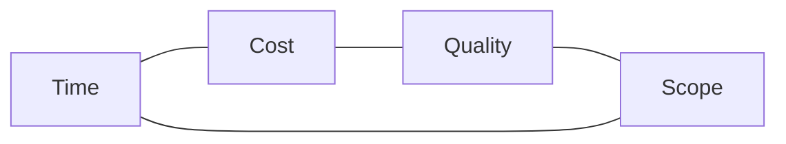

**Project management** is how an organisation turns strategy into results: it runs a temporary, unique piece of work within limits of time, cost, quality and scope.

## Remember

**One project, from idea to close**

1. **[Why do it?](business-case.md)**
   - Problem: nobody should spend money without a reason. Solution: a business case that weighs benefit, cost and risk.
   - Know your stakeholders: who is affected, and who has power.
2. **[How, when, how much?](planning.md)**
   - Break it down (what to make, what work, in what order), estimate, budget, then schedule.
   - The critical path is the longest chain of tasks. It sets the finish date.
3. **[What could go wrong?](risks.md)**
   - Risk might happen, an issue has happened. Rank by probability times impact.
   - Quality is planned, assured and controlled. Keep a lessons log.
4. **[Who decides?](governance.md)**
   - A project board (Executive, Senior User, Senior Supplier) sets the limits. The project manager runs it day to day inside them.
   - Choose a life cycle: waterfall or agile.
5. **[Change, then close](change-closure.md)**
   - Every change goes through a change request. Uncontrolled change is scope creep.
   - Close formally, hand over, record the lessons, then check the benefits arrived.

## Four constraints

Changing one pushes on the others. Risk sits across all four.
