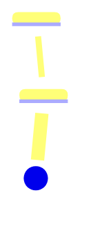

# <Concept>

**Core:** <one line>

## Key points
- <point 1>
- <point 2>
- <point 3>

## Picture

## Example
<One real, generic example. No private details.>

## Related
- [Other concept](../topic/other-concept.md)

_Updated: YYYY-MM-DD_
